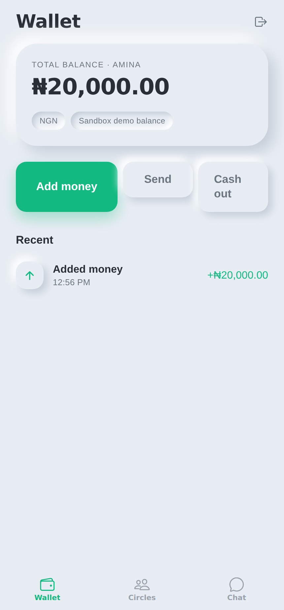
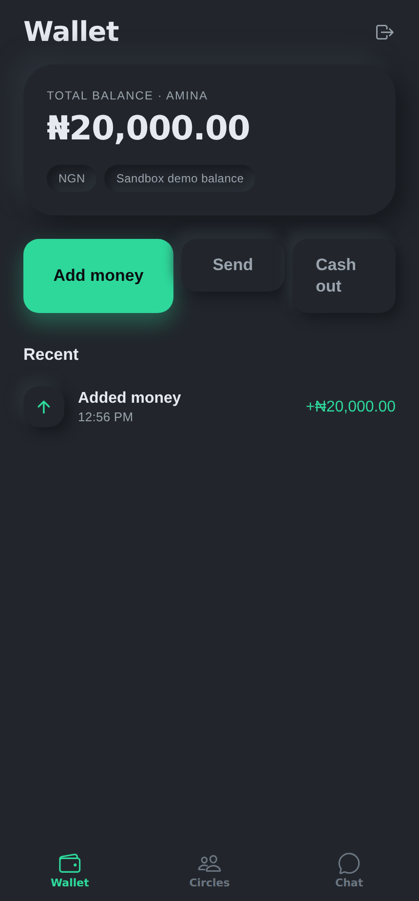
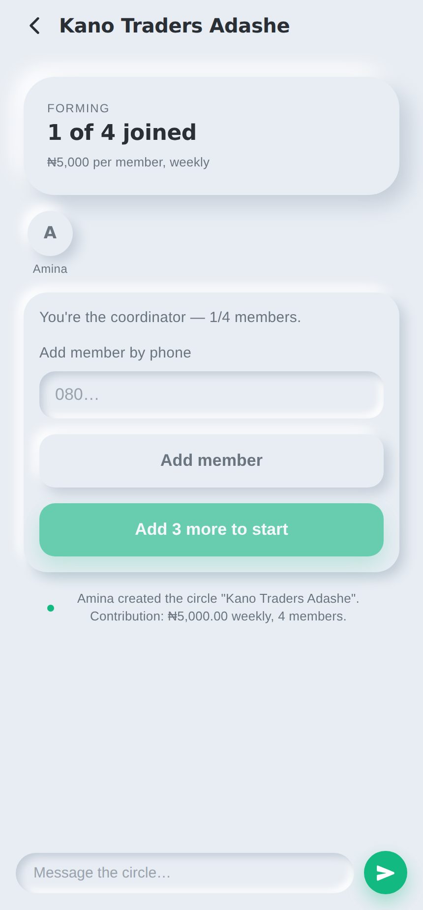

# Chat & Wallet

A social savings platform for Nigeria: a custom chat app, a ROSCA
(adashe / esusu / ajo) engine, and an in-app wallet — in one product.

See [`docs/PROJECT_BIBLE.md`](docs/PROJECT_BIBLE.md) for the vision, domain model,
and roadmap, and [`docs/DESIGN.md`](docs/DESIGN.md) for the design system.

## Status

Milestones **M0 (Foundation)**, **M1 (Wallet & ledger core)**,
**M2 (Chat core)**, **M3 (ROSCA engine)**, **M4 (Trust & robustness)**, and
**M5 (Client)** are scaffolded.

- **M0** — monorepo, PostgreSQL + migrations, phone + OTP auth, health checks, CI.
- **M1** — double-entry append-only ledger, user wallets, fund (PSP sandbox),
  in-app transfer, and cash-out with the v1 fee.
- **M2** — 1:1 and group conversations, real-time messaging over Socket.IO,
  paginated history, unread tracking, and a system-message hook for money events.
- **M3** — savings circles (adashe): create a circle (which owns a group chat and
  an escrow account), add members, set the draggable payout order, start (charging
  the cycle fee), then run each round — auto-collect contributions into escrow and
  pay the pot to the round's recipient. Every money event posts into the circle
  chat as a system message.
- **M4** — the scheduler worker that runs the clock (opens/collects/settles rounds
  on the circle's frequency), late/missed handling with one-time reminders, derived
  reputation, a coordinator dashboard, and a dispute log.
- **M5** — one Expo app (React Native + React Native Web) for iOS, Android, and web,
  built on the soft-neumorphic design system: phone + OTP sign-in, wallet, live chat
  over Socket.IO, and the full circle flow (create → add members → start → run rounds).

## The app

One Expo codebase renders on iOS, Android, and web, styled with the neumorphic +
Apple-HIG system in [`docs/DESIGN.md`](docs/DESIGN.md). Screens shown running
against the live API:

| Wallet (light) | Wallet (dark) | Savings circle |
|---|---|---|
|  |  |  |

```bash
# with the API running (see below) and PostgreSQL up
npm run build                 # build packages/shared first
cd apps/app
npx expo start                # then press w (web), i (iOS), or a (Android)
# point the app at your API with EXPO_PUBLIC_API_URL (defaults to http://localhost:4000)
```

## Repository shape

```
chat-and-wallet/
├─ docs/                 project bible + design system
├─ packages/
│  └─ shared/            money (kobo) helpers, domain types, zod schemas, fees, design tokens
└─ apps/
   └─ api/               Express + PostgreSQL + Socket.IO (server + worker)
      ├─ auth            phone + OTP, JWT + refresh rotation
      ├─ wallet          double-entry ledger, fund/transfer/cash-out
      ├─ chat            conversations, messages, real-time, system messages
      ├─ rosca           circles, payout order, round engine, scheduler, trust, disputes
      └─ worker.ts       scheduler process (runs the ROSCA clock on an interval)
   └─ app/               Expo app (React Native + Web): auth, wallet, chat, circles
```

The API server and the scheduler worker share one codebase and database; the
worker runs as its own process (`npm run worker`). A later milestone can split it
into `apps/worker` and drive its tick from BullMQ/Redis — the work already lives
in the idempotent `processDueCircles` engine, so that move is trigger-only.

The Expo client lives in `apps/app`; the scheduler currently runs as a worker
process inside `apps/api` (`npm run worker`). Splitting it into a standalone
`apps/worker` and extracting a typed `packages/sdk` are follow-ups (see the
bible's roadmap).

## Getting started

Requires Node 20+ and Docker (for local PostgreSQL).

```bash
# 1. Install workspaces
npm install

# 2. Start PostgreSQL
docker compose up -d

# 3. Configure the API
cp apps/api/.env.example apps/api/.env    # tweak if needed

# 4. Build shared + api, then run migrations
npm run build
npm run migrate

# 5. Run the API
npm run dev:api
```

The API listens on `http://localhost:4000`.

## Money model (important)

Money is **integer kobo** everywhere (1 naira = 100 kobo) — never floats.
Balances are **derived** from an append-only, double-entry ledger; nothing
mutates a balance column. Every movement is one balanced transaction (debits ==
credits), enforced by a database trigger. See `docs/PROJECT_BIBLE.md` §3.3.

## API (M0 + M1 + M2 + M3 + M4)

| Method | Route | Auth | Purpose |
|---|---|---|---|
| `GET`  | `/health` | — | Liveness |
| `GET`  | `/health/ready` | — | Readiness (checks DB) |
| `POST` | `/auth/otp/request` | — | Send a one-time code to a phone |
| `POST` | `/auth/otp/verify` | — | Verify code → tokens (creates user if new) |
| `POST` | `/auth/refresh` | — | Rotate refresh token |
| `POST` | `/auth/logout` | — | Revoke a refresh token |
| `GET`  | `/auth/me` | Bearer | Current user |
| `GET`  | `/wallet` | Bearer | Wallet balance |
| `GET`  | `/wallet/history` | Bearer | Recent ledger movements |
| `POST` | `/wallet/fund` | Bearer | Fund wallet via PSP (sandbox) |
| `POST` | `/wallet/transfer` | Bearer | Send money to another user in-app |
| `POST` | `/wallet/cashout` | Bearer | Withdraw to a bank account (amount + fee) |
| `GET`  | `/conversations` | Bearer | List conversations (last message + unread) |
| `POST` | `/conversations` | Bearer | Open a direct chat or create a group |
| `GET`  | `/conversations/:id/messages` | Bearer | Paginated history (`?before=<seq>&limit=`) |
| `POST` | `/conversations/:id/messages` | Bearer | Send a message |
| `POST` | `/conversations/:id/read` | Bearer | Mark read up to a message `seq` |
| `GET`  | `/circles` | Bearer | List circles the caller belongs to |
| `POST` | `/circles` | Bearer | Create a circle (caller = coordinator) |
| `GET`  | `/circles/:id` | Bearer | Circle detail (members, rounds, contributions) |
| `POST` | `/circles/:id/members` | Coordinator | Add a member by phone |
| `PUT`  | `/circles/:id/order` | Coordinator | Set the draggable payout order |
| `POST` | `/circles/:id/start` | Coordinator | Start the cycle (charges cycle fee, opens round 1) |
| `POST` | `/circles/:id/collect` | Coordinator | Auto-collect due contributions for the open round |
| `POST` | `/circles/:id/settle` | Coordinator | Pay out the pot and open the next round |
| `GET`  | `/circles/:id/dashboard` | Member | Who's paid, who's late, pot progress |
| `GET`  | `/circles/:id/disputes` | Member | List the circle's disputes |
| `POST` | `/circles/:id/disputes` | Member | Raise a dispute |
| `POST` | `/circles/:id/disputes/:disputeId/resolve` | Coordinator | Resolve or withdraw a dispute |
| `GET`  | `/users/me/reputation` | Bearer | Derived trust signal (on-time rate, misses, circles) |

`collect`/`settle` can be driven manually, but the **scheduler worker**
(`npm run worker`) calls them automatically on each circle's `frequency`,
sending reminders and marking missed contributions along the way.

Phone numbers are accepted in any common Nigerian format (`08012345678`,
`+2348012345678`, …) and normalized to E.164.

In development, OTP codes are printed to the API logs (`SMS_PROVIDER=console`)
and the PSP is simulated (`PSP_PROVIDER=sandbox`).

### Real-time (Socket.IO)

The API also serves a Socket.IO endpoint on the same port. Clients authenticate
in the handshake and are auto-joined to a room per conversation they belong to:

```js
import { io } from 'socket.io-client';
const socket = io('http://localhost:4000', { auth: { token: accessToken } });
socket.on('message:new', (message) => { /* render it */ });
socket.on('conversation:updated', ({ conversationId }) => { /* refresh list */ });
```

Sending still goes through `POST /conversations/:id/messages`; the server
persists the message and pushes `message:new` to the room in real time. System
messages (e.g. "Amina contributed ₦5,000") arrive on the same channel.

### Try it

```bash
# Request a code (printed to the API logs in dev)
curl -sX POST localhost:4000/auth/otp/request \
  -H 'content-type: application/json' -d '{"phone":"08012345678"}'

# Verify it → returns { user, tokens }
curl -sX POST localhost:4000/auth/otp/verify \
  -H 'content-type: application/json' \
  -d '{"phone":"08012345678","code":"123456","displayName":"Amina"}'

# Fund the wallet (₦5,000 = 500000 kobo)
curl -sX POST localhost:4000/wallet/fund \
  -H "authorization: Bearer $ACCESS_TOKEN" \
  -H 'content-type: application/json' -d '{"amount":500000}'
```

## Scripts

| Command | What |
|---|---|
| `npm run build` | Build all workspaces |
| `npm run typecheck` | Type-check all workspaces |
| `npm test` | Run unit + integration tests |
| `npm run migrate` | Apply pending SQL migrations |
| `npm run dev:api` | Run the API in watch mode |
| `npm run dev:worker` | Run the scheduler worker in watch mode |

Tests that need a database are skipped automatically when `DATABASE_URL` is
unset, so `npm test` runs the pure unit tests anywhere.
